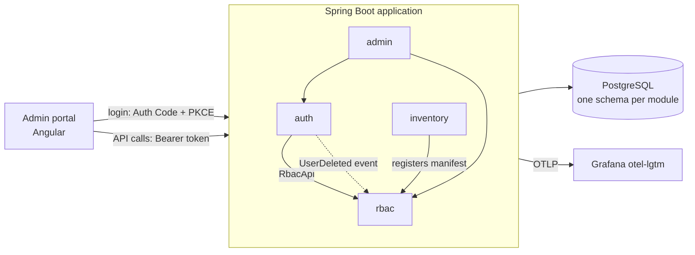

# Auth & RBAC Platform

An authentication service and a central role-based access control (RBAC) service, with global roles and per-application roles, plus a small inventory app that uses them.

- **Authentication:** an OAuth2 / OpenID Connect provider built with Spring Authorization Server (login, Authorization Code + PKCE, Client Credentials, refresh tokens).
- **Authorization:** applications register their own permissions and roles through a manifest; users get global roles (`platform-admin`, `user`) and application roles (`inventory:editor`).
- **Two ways to check permissions:** in the access token (fast, applies at refresh) and at runtime (immediate, for sensitive actions like deletes).

## Why this project exists

This is a study project. It covers the whole life of a web application, not only the code: design, module boundaries, database migrations, security, tests, containers, CI/CD, observability and deployment.

It is built twice, with the **same domain and rules**:

1. **v1, modular monolith:** one Spring Boot application with strict module boundaries, verified by tests.
2. **v2, microservices:** the same modules split into services behind an API gateway, with a database per service, events over RabbitMQ, caching, resilience and distributed tracing, deployed on Kubernetes.

The goal is to see what a well-structured monolith buys you, what changes when you split it, and what that split costs. The v1 to v2 migration will be written up here when v2 is done.

## Status

**v1, Phase 0 (project skeleton)** is in progress. The application starts, connects to PostgreSQL, runs its migrations and verifies its module boundaries; there are no business features yet.

Progress is tracked in the [milestones](https://github.com/eduMalagutti/auth-rbac/milestones): one issue per phase, one branch and pull request per phase.

## Architecture (v1)

One Spring Boot application split into four modules. Modules talk to each other only through a public interface or an application event, never through each other's classes or tables. [Spring Modulith](https://spring.io/projects/spring-modulith) checks these rules on every build.



| Module | Responsibility |
|---|---|
| `auth` | Users, credentials, login, OAuth2 Authorization Server; adds permissions and roles to tokens |
| `rbac` | Applications, permissions, roles, assignments; answers "can user X do Y?" |
| `admin` | REST API for the admin portal and the user's own account |
| `inventory` | Demo app: CRUD on items, protected by RBAC permissions |

**Tech stack:** Java 25, Spring Boot 4, Spring Security 7, Spring Modulith, PostgreSQL, Liquibase, Testcontainers, Gradle, Docker Compose, OpenTelemetry with Grafana. Angular for the portal (Phase 7).

## Running it

### Prerequisites

- **Docker**, running. The app starts its own PostgreSQL, Mailpit and Grafana containers, and the tests use Testcontainers.
- **A JDK 17 or newer** to start Gradle. The project itself builds and runs on **Java 25**, which Gradle downloads automatically if it isn't installed.

### Commands

```bash
./gradlew bootRun     # run the app; starts the containers in compose.yaml automatically
./gradlew build       # compile, check formatting, run all tests
./gradlew spotlessApply  # format the code (rules in style/)
./gradlew unitTest    # also moduleTest, integrationTest: one kind of test
```

The first `bootRun` takes a minute or two while Docker pulls the images.

### Local URLs

| What | URL |
|---|---|
| Application | http://localhost:8080 |
| Health | http://localhost:8080/actuator/health |
| Mailpit (emails sent by the app) | http://localhost:8025 |
| Grafana (metrics, logs, traces) | http://localhost:3000 |

Stopping the app (`Ctrl+C`) also stops the containers.

## Documentation

| Doc | What's in it |
|---|---|
| [`docs/PROJECT_SPEC_SUMMARY.md`](docs/PROJECT_SPEC_SUMMARY.md) | Full spec: goals, RBAC model, roadmap by phase, database rules |
| [`docs/architecture/`](docs/architecture/) | Modules and boundaries, testing strategy |
| [`docs/CODING_STANDARDS.md`](docs/CODING_STANDARDS.md) | Coding standards, routed by file and topic |

## How it's built

The project is developed with AI agents, following **Matt Pocock's setup** and his engineering skills ([`mattpocock/skills`](https://github.com/mattpocock/skills)): a short `AGENTS.md`, details in `docs/`, each issue built test-first and checked for bugs before committing, then a two-axis review (coding standards, and the issue's requirements) on every pull request through [PR-Agent](https://github.com/the-pr-agent/pr-agent). The principle: *first make it work, then make it good.* Details in [AI-Assisted Development](docs/PROJECT_SPEC_SUMMARY.md#ai-assisted-development).

## License

Public domain, see [LICENSE](LICENSE) (The Unlicense).
