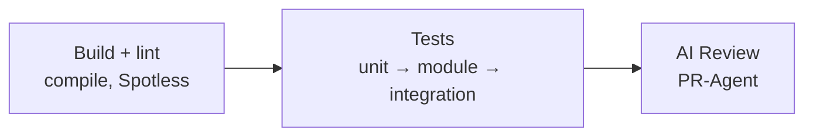
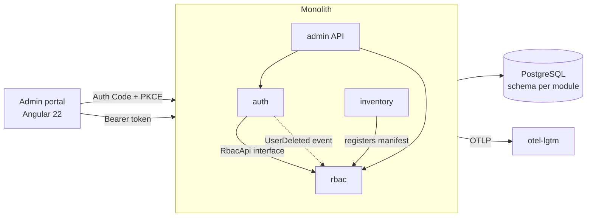
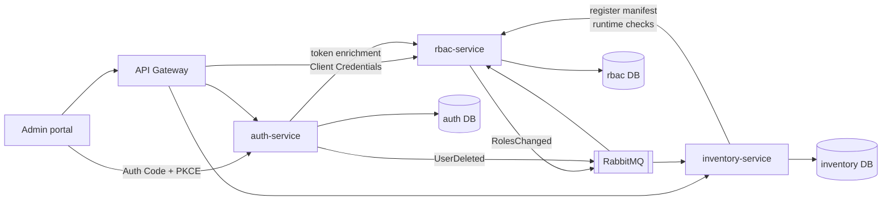

# Auth & RBAC Platform: Project Spec Summary

A study project to learn **Java 25**, **Spring Boot 4 / Spring Security 7**, OAuth2, and **microservices architecture**. It builds an authentication service and a central RBAC service with global and per-application roles, plus a simple inventory app that uses them.

The project has two versions with the **same domain and rules**:

- **v1 (Modular monolith):** one application with strict module boundaries (auth, rbac, admin, inventory).
- **v2 (Microservices):** the modules become independent services behind an API gateway, with events, caching, resilience, and distributed tracing.

CI/CD, containers, and observability are set up from the first stage. Kubernetes comes at the end of v2, once there are several services to deploy.

The README should tell the migration story: what changed from v1 to v2, and why.

## Goals

- Understand OAuth2 / OpenID Connect from the provider side, not only as a consumer.
- Separate **authentication** (who you are) from **authorization** (what you may do) into distinct modules, then distinct services.
- Design a per-application role model, similar to Keycloak client roles or Entra app roles.
- Compare permissions in tokens vs. runtime authorization checks, and their trade-offs.
- Learn microservices patterns: gateway, database per service, events, resilience, distributed tracing.
- Learn to containerize, observe, and deploy the platform on Kubernetes.
- Practice modern Java 25 (records, sealed types, pattern matching, virtual threads) and contract-first API design with OpenAPI.
- Produce a clean, well-tested, documented repository for GitHub.
- Practice an AI-assisted workflow: lean agent context, documented standards, and automated AI code review in CI.

## Tech Stack

| Area | v1 | v2 adds |
|---|---|---|
| Language | Java 25 (Gradle toolchain), virtual threads, compact object headers | |
| Framework | Spring Boot 4, Spring Security 7 | |
| Identity | OAuth2 Authorization Server (part of Spring Security 7) | |
| Architecture | Spring Modulith (module boundaries, in-process events) | Spring Cloud Gateway |
| Persistence | Spring Data JPA, PostgreSQL, Liquibase | One database per service |
| Messaging | Modulith application events | RabbitMQ (event externalization) |
| Resilience | | Resilience4j (timeouts, circuit breaker) |
| Caching | | Caffeine (per-service permission cache) |
| Observability | Actuator, Micrometer + OpenTelemetry (metrics, logs, traces), `grafana/otel-lgtm` | Distributed traces across services |
| Build | Gradle (Groovy DSL) with the wrapper; JDK provisioned by the toolchain | Gradle multi-project build |
| API contract | OpenAPI (design-first) + OpenAPI Generator; validation rules in the spec; MapStruct for mapping | |
| Frontend | Angular 22, OIDC client library (Auth Code + PKCE) | |
| Testing | JUnit 5, Mockito, AssertJ, Spring Security Test, Testcontainers, Modulith tests; Vitest + Playwright | Contract and end-to-end tests across services |
| Quality | Spotless (rules in `style/`: Palantir Java Format, import bans, whitespace hygiene), `lombok.config` bans, MapStruct unmapped-field errors | |
| Containers | OCI images (Spring Boot buildpacks or Jib), Docker Compose for local development | One image per service |
| CI/CD | GitHub Actions, images published to GitHub Container Registry (GHCR) | Per-service pipelines |
| Kubernetes | | kind (local cluster), Kustomize, ingress controller |
| AI tooling | Matt Pocock's setup: `AGENTS.md` + `docs/`, his engineering skills, PR-Agent (open source, `the-pr-agent/pr-agent`) as the AI reviewer in CI, models through OpenScale | |

---

## AI-Assisted Development

The AI setup is **based on Matt Pocock's setup**: his engineering skills ([`mattpocock/skills`](https://github.com/mattpocock/skills)) and the way he splits context between agents. Three ideas from it drive everything below:

1. **`AGENTS.md` is a short map.** It is pushed into every agent's context, so it holds little more than navigation pointers; the details live in `docs/` and are loaded only by the agents that need them.
2. **Implementation and review are separate stages.** The implementing agent carries the most context pressure (exploring, coding, debugging), the reviewing agent the least (it only reads a diff). So **coding standards are imposed by the reviewer, not the implementer**: *first make it work, then make it good.*
3. **Every mistake improves the environment.** After a build, `/retro` turns mechanical mistakes into automated checks and judgement calls into coding standards.

### The flow

Matt Pocock's main flow, as it applies here (see `/ask-matt` for the full map):

| Step | Skill | In this project |
|---|---|---|
| Sharpen the idea | `/grill-with-docs` | Interview that records decisions in `GLOSSARY.md` and `docs/adr/` |
| Write the spec | `/to-spec` | For larger features; the phases in this file play that role today |
| Split into tickets | `/to-tickets` | GitHub issues with blocking edges (the phase issues were created by hand) |
| Build a ticket | `/build-ticket` (ours, replaces `/implement`) | Test-first (`/tdd`), then a **bug review** in a fresh sub-agent, fixes with regression tests, then a commit; one fresh context per ticket |
| Review | `/code-review`, run by PR-Agent on every PR | Two axes, reported separately: **Standards** (documented standards plus a code-smell baseline) and **Spec** (does it do what the issue asked). Can also be run by hand. |
| Look back | `/retro` | Improve `AGENTS.md`, checks and standards after a build |

`/setup-matt-pocock-skills` must run once before the flow: it writes `docs/agents/` (issue tracker, domain docs layout) and an `## Agent skills` block into the steering file.

### Where the skills live

- **`.agents/skills/<name>/`**: the skills, installed from `mattpocock/skills` and pinned with hashes in `skills-lock.json`. Don't edit them in place: an update reinstalls them. Project-specific behavior goes in `AGENTS.md`, `docs/`, or a skill of our own.
- **`.agents/skills/build-ticket/`**: our one skill, not from `mattpocock/skills` (so not in `skills-lock.json`). It replaces `/implement`; see *Where each review runs* below.
- **`.claude/skills/<name>`**: symlinks to `.agents/skills/`, so Claude Code finds them.
- **OpenCode** reads both `.agents/skills/` and `.claude/skills/`. If it lists each skill twice, set `OPENCODE_DISABLE_CLAUDE_CODE_SKILLS=1`.
- **No `CLAUDE.md`:** Claude Code (v2.1.277+) and OpenCode both read `AGENTS.md` directly when there is no `CLAUDE.md`. Adding a `CLAUDE.md` would make Claude Code read it *instead*, and `/setup-matt-pocock-skills` would write its block there, where OpenCode can't see it.
- Each skill's `agents/openai.yaml` is display metadata for Codex.

### Repository layout for AI context

```
AGENTS.md                   # short map: what the project is, commands, where to find more (read by every agent)
.pr_agent.toml              # PR-Agent: model, repo context files, review instructions
skills-lock.json            # installed skills and their hashes
.agents/skills/             # Matt Pocock's skills (code-review, to-spec, to-tickets, ...) + our build-ticket
.claude/skills/             # symlinks to .agents/skills/ for Claude Code
docs/
├── README.md               # what's in docs/ and who reads it
├── CODING_STANDARDS.md     # entry point for standards: routes to the right file in standards/
├── PROJECT_SPEC_SUMMARY.md # this file
├── agents/                 # written by /setup-matt-pocock-skills: issue tracker, domain docs
├── architecture/           # how the project is organized (for humans and all agents)
│   ├── modules.md          # modules, boundaries, public APIs, events
│   └── testing-strategy.md # what to test where, Testcontainers, Modulith tests
└── standards/              # coding standards, read during review only
    ├── backend.md          # Java/Spring
    └── frontend.md         # Angular
GLOSSARY.md, docs/adr/      # created lazily by /grill-with-docs as terms and decisions settle
```

- **`AGENTS.md`** stays short: a project summary, build and test commands, and links into `docs/`. It contains no coding standards.
- **`docs/architecture/`** describes the project's structure, its modules and the testing strategy. Any agent (or person) reads it to find its way around.
- **`docs/CODING_STANDARDS.md`** is the single entry point for standards, and the file Matt Pocock's `code-review` skill looks for. It is a router: it maps file paths and topics to the right file in `docs/standards/`, so a reviewer loads only the standards that apply to the diff.
- **`docs/standards/`** holds the standards themselves, split by layer. Reviewing agents reach them through the router; the implementing agent does not load them, so its context stays lean.

### Agent roles

| Agent | Context it loads | Responsibility |
|---|---|---|
| Implementer (`/build-ticket`, `/tdd`) | `AGENTS.md`, `docs/architecture/`, the ticket | Make the change work, test-first, with tests passing |
| Bug review (sub-agent inside `/build-ticket`) | The diff and the ticket | Find correctness bugs right after implementation; the implementer fixes them with regression tests before committing |
| Standards and spec review (`code-review` skill) | `docs/CODING_STANDARDS.md` (and the files it routes to), the smell baseline, the issue | Make it good: standards, smells and module boundaries; and check the PR against its issue |
| PR-Agent (CI) | `.pr_agent.toml`, plus the `code-review` skill, `AGENTS.md`, `docs/CODING_STANDARDS.md`, `docs/standards/*.md` and `docs/architecture/*.md` through `repo_context_files` | Run the `code-review` skill's two axes on every PR, and post small fixes as committable suggestions |

### Where each review runs (decided)

| Review | When | Who | Why there |
|---|---|---|---|
| **Bug review** (correctness only) | End of `/build-ticket`, before the commit | A fresh sub-agent; the implementer fixes what it finds | Bugs are part of "make it work": fix them while the context is fresh |
| **Standards and spec review** (Matt Pocock's `code-review`) | On every PR | PR-Agent in CI, with committable suggestions | "Make it good" happens after it works, in the reviewer with the least context pressure |

- **Why our own skill:** Matt Pocock's `/implement` ends by calling `code-review`, which would run the standards review locally. Editing his skill in place would be undone by the next update, so `/build-ticket` copies its steps and ends with a bug review instead. His skills stay untouched.
- **Why not Claude Code's built-in bug review:** it is also named `code-review`, so the project skill hides it; and it doesn't exist in OpenCode. The bug review in `/build-ticket` is a sub-agent brief, so it works in any harness.
- `/code-review` can still be run by hand at any time (for example before opening a PR).

### Tests (decided)

**Tests are written by the implementer, test-first, with `/tdd`** (one red-green slice at a time). There is no separate test-writing agent: TDD needs the test and the code in the same loop, and Matt Pocock's flow builds every ticket that way. Bugs found by the bug review also get a failing test before the fix.

### CI pipeline



**Implemented** in `.github/workflows/ci.yml`, on pull requests and pushes to `main` and `v1-modular-monolith`:

| Job | Steps | Notes |
|---|---|---|
| **Build and lint** | `./gradlew assemble testClasses`, then `./gradlew spotlessCheck` | Rules in `style/spotless.gradle`; a wildcard import or unformatted file fails the job |
| **Tests** (`needs: build`) | `./gradlew unitTest`, then `moduleTest`, then `integrationTest` | Cheapest first, a failing kind stops the rest; reports uploaded as the `test-reports` artifact on every run |
| **AI Review** (`needs: test`) | PR-Agent `/review` and `/improve`, pinned by image digest (0.49.0) | Pull requests only; skips drafts and forks. Needs the `OPENSCALE_API_KEY` secret: without it the review fails, which never blocks the merge. Advisory (`continue-on-error`). Assumes CI passed, since it only runs after the test job. `/describe` is off so the PR description (with `Closes #N`) is never rewritten. |

- **Why a digest and not `uses: the-pr-agent/pr-agent@main`:** the action wrapper builds `FROM pragent/pr-agent:github_action`, a rolling tag, so even pinning the action to a release tag runs whatever PR-Agent version was published last. Only the image digest fixes the version (the action's own `action.yaml` recommends this).
- AI Review also skips PRs opened by bots: Dependabot PRs get a read-only token and only Dependabot secrets, so the review couldn't run anyway.
- Test kinds are chosen by annotation, not by folder: no annotation = unit, `@ModuleTest` = module, `@IntegrationTest` = integration (see [`architecture/testing-strategy.md`](architecture/testing-strategy.md)). `./gradlew test` and `build` still run all of them.
- A new push cancels the run still in progress for the same PR or branch. The workflow can only read the repository (`permissions: contents: read`).
- Each stage runs only if the previous one passed (`needs:` in GitHub Actions). PR-Agent never reviews code that doesn't build or pass tests, which saves tokens and keeps the review about quality, not breakage.
- **No CI results passed to the review:** the AI Review job only starts when build, lint and all tests passed (`needs: test`), so PR-Agent is told to assume a green build instead of reading test reports. Whether new behavior *has* tests is still part of its review, from the diff and the testing strategy. (PR-Agent can take CI files through `artifact_path` if that's ever needed, e.g. a coverage report.)
- PR-Agent posts its review as PR comments. To start with, it is advisory: it does not block the merge.
- **Committable suggestions:** `/improve` posts its code suggestions as GitHub "suggested changes" (`committable_code_suggestions = true`), so a fix is committed from the PR with one click. Only suggestions whose replacement range PR-Agent can verify get the button; the rest stay regular comments. `focus_only_on_problems = false` lets suggestions cover standards and smells, not just bugs, since the pipeline is where "make it good" happens.
- **LLM provider: OpenScale.** PR-Agent calls models through LiteLLM, and OpenScale exposes an OpenAI-compatible API (`https://api.openscale.so/v1`), so it is configured as an OpenAI-compatible endpoint:
  - `.pr_agent.toml`: `model = "openai/deepseek/deepseek-v4.1-flash-1017"` (LiteLLM's `openai/` prefix, then OpenScale's model id, pinned to a fixed version) and `custom_model_max_tokens = 200000`, because the model isn't in PR-Agent's token-limit table. OpenScale serves a ~1M-token context; 200k is a deliberate cap, since review quality drops on huge prompts.
  - `[ignore]` keeps vendored and generated files (`.agents/skills/`, `.claude/skills/`, `skills-lock.json`, the Gradle wrapper) out of the review and its token budget.
  - Workflow env: `OPENAI.KEY: ${{ secrets.OPENSCALE_API_KEY }}` and `OPENAI.API_BASE: https://api.openscale.so/v1`. The endpoint and key stay in the workflow, not in the repo config, because they decide where the code and the key are sent.
  - The key is a repository secret, `OPENSCALE_API_KEY`. Secrets are not available to pull requests from forks, so the review is skipped on those.
- **How PR-Agent runs Matt Pocock's `code-review` skill:** PR-Agent can't run skills (no sub-agents, no tools), but it reads repository files into its prompt through `[config] repo_context_files` (default `["AGENTS.md"]`, single-directory globs allowed). We list the skill itself (`.agents/skills/code-review/SKILL.md`), `AGENTS.md`, `docs/CODING_STANDARDS.md`, `docs/standards/*.md` and `docs/architecture/*.md`. The `extra_instructions` map the skill onto PR-Agent: skip its process steps (git commands, sub-agents), apply its two axes, and report **Standards** and **Spec** separately without reranking. The skill and the standards each live in one place; nothing is copied.
- **Differences from running the skill locally:** PR-Agent can't follow the router, so it loads every listed file in full on every PR, within a shared `repo_context_max_lines` budget, set to 1000 lines (about 450 used today). That budget covers only these docs, not the PR diff, which has its own room inside `custom_model_max_tokens`; at the cap, a 500-line PR still fits in roughly 30-40k of the 200k tokens. Its Spec axis uses its own ticket analysis of the linked issue. If the docs outgrow the budget, narrow the list in `.pr_agent.toml`.
- **Which branch the config and context come from:** by default PR-Agent reads both `.pr_agent.toml` and the context files from the default branch (`main`), so a PR can't change the rules it is reviewed against. During v1, `main` has neither, so:
  - **Config file:** the workflow sets `PR_AGENT_CONFIG_BRANCH: v1-modular-monolith`. This moves the trust boundary to that branch, so it must stay a fixed, maintainer-controlled branch (protected, changed only through reviewed PRs). Never set it from PR input such as `${{ github.head_ref }}`: any branch could then supply its own `extra_instructions` or turn the review off. If the file can't be loaded from that branch, PR-Agent falls back to `main` with a warning.
  - **Context files:** `.pr_agent.toml` sets `repo_context_from_default_branch = false`, so the docs are read from the PR's target branch. A PR can only target a branch that already exists in the repo, which only maintainers can create.
  - When v1 is merged into `main`, remove `PR_AGENT_CONFIG_BRANCH` and go back to the defaults.
- **Tickets are GitHub issues** (no Jira). PR-Agent's ticket analysis (`require_ticket_analysis_review`) finds the issue from `#N` / `Closes #N` in the PR title or description, and on GitHub also from the number in the branch name (`2-auth` gives `#2`). It then checks the PR against the issue's tasks and acceptance criteria.

### Note: PR-Agent with a self-hosted Jira

Not used in this project (tickets are GitHub issues). Kept for reusing this setup at work, where Jira is self-hosted (Server / Data Center).

- **PR-Agent can't fetch self-hosted Jira tickets.** Only Jira Cloud is supported: the base URL is built as `https://<site>.atlassian.net`, and `jira_site` is host-only, so `.pr_agent.toml` can't point it elsewhere. PR-Agent still *recognizes* keys like `PROJ-123` in the branch name, PR title or description; it just can't look them up.
- **Workaround:** fetch the ticket in CI and pass it in as an artifact (the same `artifact_path` mechanism used for test results):

```yaml
- name: Fetch Jira ticket
  env:
    JIRA_URL: https://jira.yourcompany.com        # fixed, never from PR input
    JIRA_PAT: ${{ secrets.JIRA_PAT }}             # Jira Server/DC personal access token
    BRANCH: ${{ github.head_ref }}
  run: |
    KEY=$(echo "$BRANCH" | grep -oE '^(PROJ|OPS)-[0-9]+' || true)   # allowlisted projects only
    [ -z "$KEY" ] && exit 0
    curl -sf -H "Authorization: Bearer $JIRA_PAT" "$JIRA_URL/rest/api/2/issue/$KEY?fields=summary,description,status" \
      | jq -r '"# \(.key): \(.fields.summary)\n\nStatus: \(.fields.status.name)\n\n\(.fields.description // "")"' \
      > ticket.md

- uses: the-pr-agent/pr-agent@main
  with:
    artifact_path: ticket.md
    artifact_instructions: "This is the Jira ticket for this PR. Check the PR implements what it asks."
```

- **Things to plan for:**
  - **Network:** GitHub-hosted runners usually can't reach an internal Jira; use a self-hosted runner or CI inside the company network.
  - **Untrusted input:** the branch name comes from the PR author. Accept only keys matching a strict pattern from allowlisted projects, keep the Jira URL fixed in the workflow, and use a read-only PAT from a service account limited to the relevant projects.
  - **Format:** older Jira versions return descriptions as wiki markup, not Markdown; readable by the model, just noisier.
  - **Size:** artifacts are truncated at about 50k characters, so fetch only the fields needed.
- **Alternatives:**
  - Run the spec review with the `code-review` skill plus a Jira MCP server that supports Server / Data Center with a PAT (e.g. the community `mcp-atlassian`). It runs where Claude runs, inside the company network, so no runner access is needed.
  - Self-hosted support in PR-Agent itself: its docs say it "can be added once base-URL handling for the self-hosted case is settled", so a contribution there is a possibility.

---

## RBAC Model

### Naming convention

| Concept | Format | Examples |
|---|---|---|
| Application | `<app>` | `auth`, `rbac`, `inventory` |
| Permission | `<app>:<resource>:<action>` | `inventory:item:read`, `rbac:role:assign`, `auth:user:read` |
| Application role | `<app>:<role>` | `inventory:viewer`, `inventory:editor`, `inventory:manager` |
| Global role | `<role>` | `platform-admin`, `user` |

- **Permissions** are the fine-grained actions an application checks in code.
- **Application roles** are named bundles of one application's permissions.
- **Global roles** are identity-level and cross-application, included in every token.
- **Applications register their own permissions and roles** through a manifest. The platform's own apps (`auth`, `rbac`) are registered the same way.
- **Resource-level rules** (e.g. "creator of this item") are never in the RBAC model; they stay in the application.

### Ownership of data

- The **auth** module/service owns users, credentials, and OAuth2 clients.
- The **rbac** module/service owns applications, permissions, roles, and assignments. It references users only by `sub`.
- Applications own their domain data and resource-level rules.

### Two ways an application gets permissions

| | A: Permissions in the token | B: Runtime check |
|---|---|---|
| How | Auth asks RBAC at token issuance and embeds the permissions | The app asks RBAC per request (`can user X do Y?`), with a cache |
| Speed | Fast, no extra calls | Extra call on cache miss |
| Freshness | Changes apply at token refresh | Immediate (after cache eviction) |
| Availability | Apps work even if RBAC is down | RBAC becomes a runtime dependency |

**Strategy used in this project:** A by default; B (with caching and event-driven invalidation) for sensitive operations such as deleting items or assigning roles.

### Token example

A client requests an application's scope (e.g. `inventory`); the token gets `aud` set to that application and **only that application's permissions**, plus global roles.

```json
{
  "sub": "8f2c…",
  "aud": "inventory",
  "scope": "openid inventory",
  "roles": ["user"],
  "permissions": ["inventory:item:read", "inventory:item:write"]
}
```

---

## Inventory Domain

The inventory app exists only to demonstrate how an application plugs into the platform, so the domain is intentionally minimal: **a single table, `item`**.

| Column | Type | Notes |
|---|---|---|
| `id` | UUID | Primary key |
| `name` | text | Required |
| `quantity` | integer | Required, ≥ 0 |
| `location` | text | Free text, e.g. "Warehouse A, shelf 3" |
| `created_by` | text | User `sub` from the token (never a copy of user data) |
| `created_at`, `updated_at` | timestamp | Audit fields |

**API:** list items (paginated), get item, create, update, delete.

**Manifest:**

```yaml
application: inventory
permissions:
  - inventory:item:read
  - inventory:item:write
  - inventory:item:delete
roles:
  inventory:viewer: [inventory:item:read]
  inventory:editor: [inventory:item:read, inventory:item:write]
  inventory:manager: [inventory:item:read, inventory:item:write, inventory:item:delete]
```

| Role | Can do | Demonstrates |
|---|---|---|
| `inventory:viewer` | List and view items | Basic token-based check |
| `inventory:editor` | Create and update items | Token-based checks with `@PreAuthorize` (Strategy A) |
| `inventory:manager` | Everything, including delete | Runtime check on delete (Strategy B): revoking the role blocks deletes immediately, even with an old token |

**Optional resource-level rule:** editors may update only items they created (`created_by`), while managers may update any item. This shows a rule that belongs to the application, not to the RBAC model.

---

## Observability

All telemetry is produced with **Micrometer + OpenTelemetry** and sent over OTLP to **`grafana/otel-lgtm`**: a single, free, open-source container bundling an OpenTelemetry collector, Tempo (traces), Prometheus/Mimir (metrics), Loki (logs), and Grafana (UI). It runs in Docker Compose (and in the cluster in v2's last phase).

```yaml
services:
  otel-lgtm:
    image: grafana/otel-lgtm
    ports:
      - "3000:3000"   # Grafana UI
      - "4317:4317"   # OTLP gRPC
      - "4318:4318"   # OTLP HTTP
```

- **v1:** metrics (HTTP, JVM, database pool), structured logs with trace IDs, and traces within the monolith. Custom security metrics: tokens issued, failed logins, lockouts, role changes. A Grafana dashboard for these.
- **v2:** distributed traces across services, e.g. one login followed through gateway → auth-service → rbac-service, including the token enrichment call.

---

## v1: Modular Monolith

One Spring Boot application, with modules that communicate only through public interfaces and application events. Spring Modulith verifies the boundaries in a test, so the v2 split is mechanical rather than a rewrite.



### Modules

| Module | Responsibility |
|---|---|
| `auth` | Users, credentials, login, OAuth2 Authorization Server, token customizer |
| `rbac` | Applications, permissions, roles, assignments, manifest registration, permission queries |
| `admin` | Admin and account REST API used by the portal |
| `inventory` | CRUD on items (one table); declares its manifest |

Rules: no module touches another module's entities or tables; each module has its own database schema; cross-module calls go through a public API interface or events.

### Phase 0: Project Skeleton, CI/CD, Containers & AI Setup
- [ ] Spring Boot 4 project with Spring Modulith and empty `auth`, `rbac`, `admin`, `inventory` modules
- [ ] Modulith verification test (`ApplicationModules.of(...).verify()`) from day one
- [ ] Spotless with its rules in `style/` (plus `.editorconfig`); Checkstyle or Error Prone only if a mechanical rule appears that Spotless can't check
- [ ] Container image built with Spring Boot buildpacks (`spring-boot:build-image`) or Jib
- [ ] `compose.yaml` for local development: app, PostgreSQL, Mailpit, `otel-lgtm`
- [ ] Actuator health endpoints (liveness and readiness) and basic OTLP export to `otel-lgtm`
- [ ] GitHub Actions pipeline on every pull request, in stages: build + lint → tests (unit, module, integration) → AI review
- [ ] GitHub Actions: build and publish the image to GHCR on `main` and on tags
- [ ] Dependabot for Gradle, npm, and GitHub Actions
- [ ] `AGENTS.md`: short project summary, build/test commands, and links into `docs/` (no `CLAUDE.md`: Claude Code and OpenCode read `AGENTS.md` directly)
- [ ] `docs/architecture/`: modules, testing strategy
- [ ] `docs/CODING_STANDARDS.md` router and `docs/standards/`: backend and frontend coding standards (first version, grows with the code)
- [ ] Matt Pocock's skills installed in `.agents/skills/` (symlinked from `.claude/skills/`), with the skills they call (`tdd`, `grilling`, `domain-modeling`, `writing-for-agents`), and `/setup-matt-pocock-skills` run once (GitHub issue tracker, single-context domain docs)
- [ ] `/build-ticket` skill: `/implement` with a bug review instead of the standards review
- [ ] PR-Agent in CI with `.pr_agent.toml` (OpenScale model, `repo_context_files` with the `code-review` skill, `AGENTS.md` and `docs/`, GitHub issue ticket analysis, two-axis review instructions, committable suggestions) (see [CI pipeline](#ci-pipeline))
- [ ] Workflow env for PR-Agent: `OPENSCALE_API_KEY` secret as `OPENAI.KEY`, `OPENAI.API_BASE`, and `PR_AGENT_CONFIG_BRANCH: v1-modular-monolith`; branch protection on `v1-modular-monolith`

### Phase 1: Auth Module Foundation
- [ ] Users in PostgreSQL with a JPA-backed `UserDetailsService`; BCrypt or Argon2
- [ ] Registered clients and authorizations persisted in the database
- [ ] Authorization Code + PKCE with a login page; Client Credentials; refresh token rotation
- [ ] Persistent signing key at the JWKS endpoint; OIDC discovery working
- [ ] Liquibase changelogs, one schema and one changelog folder per module

### Phase 2: RBAC Module
- [ ] Entities: Application, Permission, ApplicationRole, GlobalRole, assignments (by user `sub`)
- [ ] Naming convention enforced; applications can only define permissions in their own namespace
- [ ] Manifest registration API (idempotent upsert; removed permissions deprecated, not deleted)
- [ ] `auth` and `rbac` registered as applications with their own manifests
- [ ] Public `RbacApi` interface: permissions of a user for an application, permission check
- [ ] Seed global roles (`platform-admin`, `user`) and a default admin
- [ ] `UserDeleted` event from `auth` removes the user's assignments in `rbac`

### Phase 3: Tokens (Strategy A)
- [ ] Application scopes (e.g. `inventory`) select the target application
- [ ] Token customizer calls `RbacApi`, sets `aud`, adds that application's `permissions` and the global `roles`
- [ ] README section documenting the **token contract** (issuer, audience, claims, naming)

### Phase 4: Inventory Module
- [ ] `item` table and entity as described in [Inventory Domain](#inventory-domain), with design-first OpenAPI
- [ ] Manifest registered with `rbac` at startup
- [ ] `@PreAuthorize("hasAuthority('inventory:item:write')")` on endpoints (Strategy A)
- [ ] Delete endpoint using a runtime check through `RbacApi` (Strategy B, in-process)
- [ ] Optional: editors update only their own items (`created_by`)
- [ ] Tests for viewer, editor, and manager (allowed and forbidden actions)

### Phase 5: Admin & Account API, Hardening
- [ ] Design-first `openapi.yaml`; server interfaces generated
- [ ] Admin endpoints: users, applications, roles, assignments (protected by `auth:*` and `rbac:*` permissions)
- [ ] Account endpoints: profile, change password, my roles, authorized apps with revoke
- [ ] Self-registration, email verification, password reset (Mailpit in Docker)
- [ ] Rate limiting / account lockout; `ProblemDetail` errors; audit log of security events

### Phase 6: Observability
- [ ] Metrics, logs (with trace IDs), and traces exported to `otel-lgtm`
- [ ] Custom security metrics: tokens issued, failed logins, lockouts, role changes
- [ ] Grafana dashboard for application health and security metrics, versioned in the repo

### Phase 7: Admin Portal (Angular 22)
- [ ] Login via Authorization Code + PKCE; token interceptor; silent refresh
- [ ] Users: list, search, assign global and application roles
- [ ] Applications: registered apps, their permissions, application roles
- [ ] Inventory screen to demo the three inventory roles
- [ ] Account page for regular users
- [ ] UI driven by permissions, while the API still enforces every rule
- [ ] TypeScript client generated from OpenAPI; Playwright end-to-end tests
- [ ] Portal container image (static build served by Nginx) built and published in CI

### Phase 8: v1 Release
- [ ] Testcontainers integration tests for all OAuth2 flows and RBAC rules
- [ ] `docker compose up` runs the full platform (app, portal, database, Mailpit, `otel-lgtm`)
- [ ] README with architecture, module diagram, RBAC model, token contract, and how to run with Docker Compose
- [ ] Tag `v1.0`

---

## v2: Microservices

The modules become independent services, each with its own database. The frontend talks only to the gateway.



All services export telemetry to `otel-lgtm` (omitted from the diagram).

### Repository Layout

```
auth-platform/
├── settings.gradle        # includes every service as a subproject
├── build.gradle           # shared conventions (toolchain, Spotless, test setup)
├── contracts/             # openapi.yaml files per service
├── auth-service/
├── rbac-service/
├── inventory-service/
├── gateway/
├── admin-portal/          # Angular 22
├── k8s/                   # Kustomize base and overlays
└── compose.yaml           # services, Postgres instances, RabbitMQ, Mailpit, otel-lgtm
```

### Services

| Service | v1 module(s) | Notes |
|---|---|---|
| `auth-service` | `auth` + account parts of `admin` | Authorization server; calls rbac-service for token enrichment |
| `rbac-service` | `rbac` + RBAC parts of `admin` | Resource server; manifest registration, permission queries and checks |
| `inventory-service` | `inventory` | Resource server; registers its manifest at startup |
| `gateway` | - | Single entry point; validates tokens at the edge and relays them |

Services still validate tokens themselves (no blind trust in the gateway).

### Phase 9: Split & Infrastructure
- [ ] Multi-project Gradle build; each v1 module becomes a service (subproject)
- [ ] Database per service (data migrated from v1 schemas)
- [ ] Spring Cloud Gateway with token relay; routes per service
- [ ] `compose.yaml` running all services with Docker DNS (no service discovery server)
- [ ] One image per service; CI builds and publishes only the services that changed
- [ ] Each service registered as an OAuth2 client where it calls others

### Phase 10: Auth ↔ RBAC over HTTP
- [ ] `RbacApi` becomes an HTTP client (`@HttpExchange`, generated from the rbac OpenAPI spec)
- [ ] auth-service authenticates to rbac-service with Client Credentials (`rbac:permissions:read` scope)
- [ ] Token enrichment over HTTP, with a timeout and a defined failure behavior (e.g. fail token issuance rather than issue a token without permissions)
- [ ] Issuer and audience validation working across the Docker network

### Phase 11: Inventory Service & Registration
- [ ] Manifest registration at startup over HTTP (Client Credentials, `rbac:register` scope)
- [ ] Registration retried with backoff if rbac-service is not ready yet
- [ ] Strategy A checks from token claims, as in v1

### Phase 12: Runtime Checks, Caching & Events
- [ ] Strategy B: runtime permission checks from inventory-service to rbac-service
- [ ] Caffeine cache of permission decisions with a short TTL
- [ ] `RolesChanged` and `UserDeleted` events externalized to RabbitMQ (Spring Modulith event externalization)
- [ ] inventory-service evicts cached permissions on `RolesChanged`; rbac-service removes assignments on `UserDeleted`
- [ ] Idempotent event handlers (safe to process the same event twice)

### Phase 13: Resilience & Distributed Tracing
- [ ] Resilience4j on all inter-service calls: timeouts, retries, circuit breaker
- [ ] Defined fallbacks: deny by default for runtime checks when rbac-service is unavailable
- [ ] Trace context propagated across HTTP calls and RabbitMQ messages
- [ ] One login traceable in Grafana across gateway, auth-service, and rbac-service
- [ ] Dashboard additions: inter-service latency, circuit breaker state, cache hit rate

### Phase 14: Kubernetes
- [ ] Local cluster with kind; ingress controller installed
- [ ] Kustomize base + `local` overlay per service: Deployments, Services, ConfigMaps, Secrets
- [ ] Gateway and auth-service exposed through the ingress; internal services not exposed
- [ ] One PostgreSQL per service (StatefulSets), RabbitMQ, Mailpit, and `otel-lgtm` in the cluster
- [ ] Liveness and readiness probes from Actuator; resource requests and limits
- [ ] Stable public hostname for the issuer (e.g. `auth.localtest.me`) so tokens are valid inside and outside the cluster
- [ ] Readiness ordering handled by registration retries, not startup dependencies
- [ ] CI job: create a kind cluster, deploy, and run end-to-end smoke tests
- [ ] Docker Compose remains the fast loop for daily development

### Phase 15: v2 Release
- [ ] Integration tests per service (Testcontainers) and end-to-end tests through the gateway
- [ ] Contract tests between services based on the OpenAPI specs
- [ ] Admin portal pointed at the gateway, unchanged otherwise
- [ ] README: how to run with Docker Compose and on Kubernetes
- [ ] README migration write-up: what changed from v1 to v2, trade-offs, and lessons learned
- [ ] Tag `v2.0`

---

## v3 (Future): Agent Access via MCP

- [ ] MCP server for the inventory service, acting as an OAuth2 resource server
- [ ] Protected Resource Metadata (RFC 9728) for authorization server discovery
- [ ] Resource indicators (RFC 8707) so tokens are bound to a single server
- [ ] Client registration for agents (Dynamic Client Registration or Client ID Metadata Documents)
- [ ] Token Exchange (RFC 8693) for downstream calls, with an `act` claim identifying the agent
- [ ] Narrow scopes, short-lived tokens, consent page naming the agent, and revocation of authorized agents

## Stretch Goals

- Social login (GitHub / Google) federated through the auth service
- Two-factor authentication (TOTP)
- Helm charts or GitOps deployment (e.g. Argo CD) on top of the Kustomize manifests

---

## Java + Spring Notes

- **Java 25** via the Gradle toolchain (the JDK is downloaded automatically if missing). Run with compact object headers (`-XX:+UseCompactObjectHeaders`, JEP 519) and virtual threads (`spring.threads.virtual.enabled`; since JEP 491, `synchronized` no longer pins carrier threads).
- Use **records** for DTOs, request/response bodies, events and value objects.
- Keep JPA entities as regular classes with **hand-written `equals`/`hashCode`**, based on the id (or a natural key) and safe with Hibernate proxies.
- **Lombok only where records don't fit:** `@RequiredArgsConstructor` for constructor injection, `@Builder`, `@Getter`, `@Slf4j`. `@Data`, `@EqualsAndHashCode` and `@Value` are banned in `lombok.config` and fail the build.
- Use **sealed interfaces** with pattern-matching `switch` for result/error types.
- Map between API models and entities with **MapStruct**; unmapped fields fail the build ([ADR 2](adr/0002-mapstruct-for-mapping.md)).
- Spring Boot 4 uses Jackson 3 and modularized starters; check the migration guide when following tutorials written for Boot 3.
- Never edit generated OpenAPI code; change the spec or generator config instead, and keep generated sources out of Git.
- Finish v1 completely (tests, CI, README, tag) before starting v2.

---

## Database, Environments & Data Integrity Notes

### Principle: the database is the source of truth

- Every invariant lives in the database: `NOT NULL`, `CHECK`, `UNIQUE`, foreign keys, defaults.
- API validation (rules written in `openapi.yaml`, enforced by Bean Validation on the generated models; [ADR 1](adr/0001-request-validation-in-openapi.md)) exists only to give friendlier, field-level error messages. If it drifts from the database rules, the database still has the final word.
- Liquibase owns the schema in every environment. Hibernate never changes it.

### Environments and configuration

| Profile | Purpose | Database |
|---|---|---|
| `dev` | Local development | PostgreSQL from `compose.yaml`, wired automatically by Spring Boot's Docker Compose support |
| `prod` | Prod-like runs: `compose.prod.yaml` with the published image, and Kubernetes in v2 | Configured only through environment variables |
| tests | Integration tests | Testcontainers with `@ServiceConnection`, same PostgreSQL major version as prod |

```yaml
# application.yml: shared, no secrets, no environment-specific values
spring:
  jpa:
    hibernate:
      ddl-auto: validate
    open-in-view: false
  liquibase:
    change-log: classpath:db/changelog/db.changelog-master.yaml

---
# application-dev.yml: local defaults that just work with compose.yaml
spring:
  docker:
    compose:
      enabled: true

---
# application-prod.yml: no defaults: missing variables fail at startup
spring:
  datasource:
    url: ${DB_URL}
    username: ${DB_USER}
    password: ${DB_PASSWORD}
    hikari:
      maximum-pool-size: ${DB_POOL_SIZE:10}
  docker:
    compose:
      enabled: false
```

- Dev works with zero setup; prod has no defaults for anything that matters (a missing `DB_URL` must crash at startup, never fall back to localhost).
- Secrets never go in the repo: environment variables, a gitignored `.env` for local prod-like runs, Kubernetes Secrets in v2.

### Liquibase rules

- The same changesets run in every environment. Environments differ in configuration, never in schema.
- Never edit a changeset once applied (Liquibase stores a checksum of each one and fails on a mismatch); fixes go into a new changeset.
- Keep `spring.liquibase.drop-first` off (the default).
- Changesets are written as **formatted SQL** (`--liquibase formatted sql`), so migrations read like plain SQL, with a `--rollback` where one makes sense.
- **One changelog folder per module:** `db/changelog/<module>/changelog.yaml` plus its SQL files; shared tables (e.g. Modulith's `event_publication`) go in `db/changelog/shared/`. The master changelog (`db.changelog-master.yaml`) includes `shared` first, then each module **in module dependency order**. In v2, each service takes its folder with it.
- Changeset ids are prefixed with the module (`rbac-003-permission-deprecated`) so they stay unique across the whole changelog.
- Trade-off of choosing Liquibase over Flyway: Spring Modulith's module-aware migrations are Flyway-only, so the module order is kept by hand in the master changelog, and module tests (`@ApplicationModuleTest`) run every module's changesets rather than only the modules under test.
- Map each entity to its module's schema explicitly, e.g. `@Table(schema = "rbac", name = "application_role")`, otherwise validation looks in `public` and reports missing tables.

### Seed data

- **Reference data needed everywhere** (global roles, the `auth` and `rbac` applications): migrations or startup manifest registration.
- **Initial admin user:** an idempotent bootstrap runner reading `BOOTSTRAP_ADMIN_EMAIL` / `BOOTSTRAP_ADMIN_PASSWORD`; it creates the admin only if none exists. Not a migration: migrations can't hash passwords properly, and credentials would end up in Git.
- **Dev-only test data** (sample users, items, test OAuth clients): a runner active only in the `dev` profile, using the real services so passwords are hashed and business rules apply.

### When migrations run

- **v1:** at application startup (Spring Boot default). Liquibase takes a lock (the `databasechangeloglock` table), so concurrent instances don't migrate twice.
- **v2 (Kubernetes):** a separate step before the rollout (a Job or init container). Run the app's own image with a `migrate` profile that runs Liquibase and exits, so the changesets and their order are identical.
- **Least privilege:** the migration step uses a database user that can change the schema; the running app uses a user that can only read and write data.
- **Expand and contract** for rolling deployments: add the new structure and deploy code that handles both; remove the old structure in a later release.

### What `ddl-auto=validate` checks (and doesn't)

| Checked at startup | Not checked |
|---|---|
| Each entity's table exists, in the expected schema | Nullability (`@Column(nullable = false)` vs. the real column) |
| Each mapped column exists | Lengths and precision |
| Column types are compatible with the Java types (e.g. `Long` over `integer` fails) | Unique constraints, foreign keys, check constraints, indexes |
| Sequences used by ID generators exist | Defaults, triggers, views |
| | Tables and columns no entity maps (ignored, which enables expand/contract) |

- `@Column(nullable, length, unique)` only matter when Hibernate generates the schema. With Liquibase, the changeset is the truth.
- `validate` is a fast structural check; integration tests are the real guarantee.

### Constraints in migrations

Name every constraint explicitly; the name is how a violation is mapped back to a clear message.

```sql
CREATE TABLE inventory.item (
    id          uuid        PRIMARY KEY,
    name        text        NOT NULL,
    quantity    integer     NOT NULL,
    location    text,
    created_by  text        NOT NULL,
    created_at  timestamptz NOT NULL DEFAULT now(),
    updated_at  timestamptz NOT NULL DEFAULT now(),
    CONSTRAINT ck_item_quantity_non_negative CHECK (quantity >= 0),
    CONSTRAINT ck_item_name_not_blank        CHECK (length(trim(name)) > 0)
);

CREATE TABLE rbac.permission (
    id              uuid    PRIMARY KEY,
    application_id  uuid    NOT NULL,
    name            text    NOT NULL,
    deprecated      boolean NOT NULL DEFAULT false,
    CONSTRAINT fk_permission_application FOREIGN KEY (application_id) REFERENCES rbac.application (id),
    CONSTRAINT uk_permission_name        UNIQUE (name),
    CONSTRAINT ck_permission_name_format CHECK (name ~ '^[a-z][a-z0-9-]*:[a-z][a-z0-9-]*:[a-z][a-z0-9-]*$')
);
```

Suggested prefixes: `pk_` primary key, `fk_` foreign key, `uk_` unique, `ck_` check, `ix_` index.

### Translating database errors into API errors

Handle `DataIntegrityViolationException` in the `@RestControllerAdvice`: read the PostgreSQL SQL state (what kind of violation) and the constraint name (which rule), and return a `ProblemDetail`.

```java
@ExceptionHandler(DataIntegrityViolationException.class)
ProblemDetail handleIntegrityViolation(DataIntegrityViolationException ex) {
    if (NestedExceptionUtils.getMostSpecificCause(ex) instanceof PSQLException psql
            && psql.getServerErrorMessage() != null) {
        String constraint = psql.getServerErrorMessage().getConstraint();
        HttpStatus status = switch (psql.getSQLState()) {
            case "23505" -> HttpStatus.CONFLICT;                      // unique_violation
            case "23503" -> HttpStatus.CONFLICT;                      // foreign_key_violation
            case "23502", "23514" -> HttpStatus.UNPROCESSABLE_ENTITY; // not_null, check
            default -> HttpStatus.BAD_REQUEST;
        };
        ProblemDetail problem = ProblemDetail.forStatusAndDetail(status, constraintMessages.messageFor(constraint));
        problem.setProperty("constraint", constraint);
        return problem;
    }
    return ProblemDetail.forStatusAndDetail(HttpStatus.CONFLICT, "Data integrity violation");
}
```

- `constraintMessages` maps constraint names to messages (e.g. `uk_permission_name` → "A permission with this name already exists"). Unknown constraints get a generic message, so raw SQL errors never reach clients.

### Data integrity tips

- **Bean Validation only on request DTOs,** not on entities, to avoid a third copy of the rules.
- **Don't check before writing.** `existsByName(...)` followed by `save(...)` fails under concurrency; insert and translate the unique violation into a 409.
- **Watch flush timing.** JPA sends inserts at flush, often at commit, so violations can surface after the method returns. The controller advice covers this; use `saveAndFlush()` when the error is needed inside the method.
- **Database-generated columns** (e.g. `created_at DEFAULT now()`): either set them in Java or mark them as generated (Hibernate's `@Generated`) so their values are read back. Pick one approach and use it consistently.
- **References across modules are eventually consistent.** No foreign keys between module schemas (and in v2 they are separate databases). Integrity across modules is maintained by events, e.g. `UserDeleted`.
- **Test every named constraint:** one integration test per constraint that violates it and checks the API's status and message. How tests are written overall is defined in one place: [`architecture/testing-strategy.md`](architecture/testing-strategy.md).
- **CI check:** apply all changesets to an empty Testcontainers database, then start the app with `ddl-auto=validate`.
- **Optional (stretch):** generate Hibernate's DDL to a file (`jakarta.persistence.schema-generation.scripts.action=create`) and diff it against the Liquibase-created schema to catch nullability and length drift (Liquibase's `diff` command can also compare two databases).
