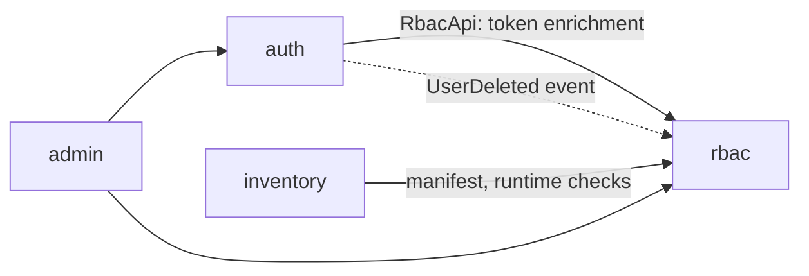

# Modules

v1 is a modular monolith built with **Spring Modulith**. Each direct subpackage of `com.esmalagutti.authrbac` is an application module. In v2 each module becomes its own service, so the boundaries here are the future service boundaries.

| Module | Package | Owns |
|---|---|---|
| `auth` | `...authrbac.auth` | Users, credentials, login, OAuth2 Authorization Server, token customizer |
| `rbac` | `...authrbac.rbac` | Applications, permissions, roles, assignments, manifest registration, permission queries |
| `admin` | `...authrbac.admin` | Admin and account REST API used by the portal |
| `inventory` | `...authrbac.inventory` | Items (CRUD); declares its RBAC manifest |

## Boundary rules

1. **Public API = the module's top-level package.** Types directly in `authrbac.rbac` (e.g. `RbacApi`) can be used by other modules. Anything in a subpackage (`authrbac.rbac.internal`, `authrbac.rbac.persistence`, ...) is internal.
2. **No shared entities or tables.** A module never reads another module's entities, repositories or tables. Each module has its own database schema.
3. **Cross-module communication** goes through a public interface (synchronous) or an application event (asynchronous).
4. **No foreign keys across schemas.** References to other modules' data are ids (e.g. a user's `sub`). Consistency is kept by events such as `UserDeleted`.

`ModularityTests` runs `ApplicationModules.of(...).verify()` on every build and fails on any violation of rules 1 and 3, and on dependency cycles.

## Dependencies between modules



`rbac` depends on no other module. It reacts to `auth` only through events.

> Not enforced yet: the allowed dependencies above will be declared with `@ApplicationModule(allowedDependencies = ...)` in each module's `package-info.java`.

## Internal structure of a module

To be filled in as Phase 1 settles the first real module. Expected shape:

```
rbac/
├── RbacApi.java          # public interface used by other modules
├── RolesChanged.java     # public event (record)
├── package-info.java
└── internal/             # everything else: entities, repositories, services, controllers
```
